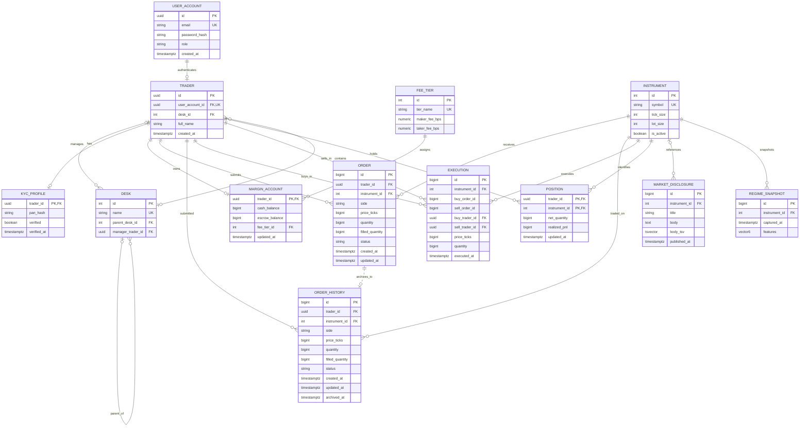

# TradeGraph ER Diagram — Day 1

## 13 physical PostgreSQL tables

## Relational cardinality and implementation notes

- A `USER_ACCOUNT` may have one `TRADER`. Compliance administrators can have a login on its own.
- `DESK.parent_desk_id` gives each desk an optional parent and lets a parent have multiple children.
- A desk can have multiple traders. A trader's desk assignment is optional.
- A desk can have one manager. A trader can manage several desks.
- Each trader can have one `KYC_PROFILE` and one `MARGIN_ACCOUNT`. The demo seeder creates both.
- `POSITION` links traders to instruments with the composite key `(trader_id, instrument_id)`.
- `EXECUTION` references both counterparties and retains the buy and sell order IDs after archival.
- The dashed archival edge shows how `ORDER_HISTORY` retains the original order ID. Archive rows have foreign keys to the trader and instrument.
